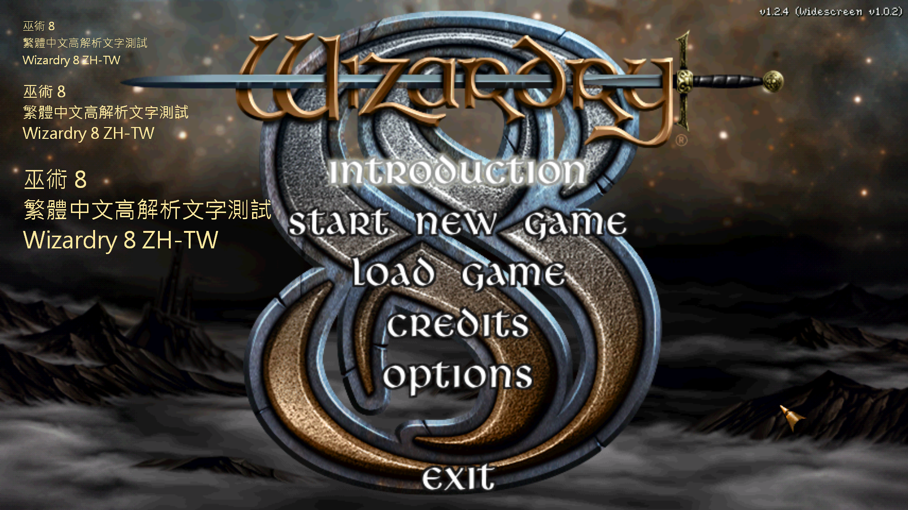

# Wizardry 8 for ZH

《巫術 8》繁體中文高解析度 Mod 的工程計畫與 PoC。

目前依 [Master Plan v2.2](WIZARDRY8_ZHTW_MASTER_PLAN_v2.2.md) 執行，首輪 **P-1、P0-A、P0-B、P1A、P1B 全部 PASS**。已證明繁中文字形可直接以實體解析度繪製，再疊合至真正的 1920×1080 遊戲畫面；尚未整合遊戲內容翻譯。首輪依計畫停止於 P1B。

## 驗證成果

- [P-1 架構決策](docs/P-1_ARCHITECTURE_DECISION.md)
- [P0 環境、基線與移植／回復驗證](docs/P0_ENVIRONMENT.md)
- [P1A Alpha 驗證](docs/P1A_ALPHA_REPORT.md)
- [P1B 高解析度繁中驗證](docs/P1B_HIRES_TEXT_REPORT.md)

P1A 的 256 級 Alpha 測試與 P1B 的文字混色逐像素比對，最大 RGB 誤差均為 0。P1B 使用本機微軟正黑體，驗證 24／32／48 px 字形、3D 場景及功能關閉。

[原尺寸主選單截圖](artifacts/p1b-hires-text/screenshot-1920x1080.png) · [原尺寸 3D 場景截圖](artifacts/p1b-hires-text/scene/screenshot-1920x1080.png)

## 原始碼與重建

此 repo 保存計畫、報告、輔助腳本、無損 readback、逐像素證據與上游修改 patch。完整上游 checkout、遊戲資料、字型 binary 與建置產物不納入版本控制；需自行準備合法的 Wizardry 8 1.2.4 安裝。

最終 P1B 修改位於：

- [`decomp.patch`](artifacts/p1b-hires-text/decomp.patch)：套用至報告指定 revision 的 decomp submodule。
- [`hybrid-config.patch`](artifacts/p1b-hires-text/hybrid-config.patch)：套用至報告指定 revision 的上游 parent repo。

精確的上游 revisions、工具版本、建置／執行指令及已知限制見各階段報告。[工作區配置](docs/WORKSPACE.md) 記錄目前 Windows 本機路徑；腳本使用該配置，移至其他機器時需相應調整。這份 PoC 不是可直接安裝的完整中文化套件。

[`first-round-manifest.json`](artifacts/first-round-manifest.json) 記錄交付檔案的 SHA-256。`.gitattributes` 保留檔案原始位元組，避免換行轉換影響證據雜湊。

v2.0、v2.1 與早期 PoC 計畫保留作歷史紀錄；目前以 v2.2 為準。
